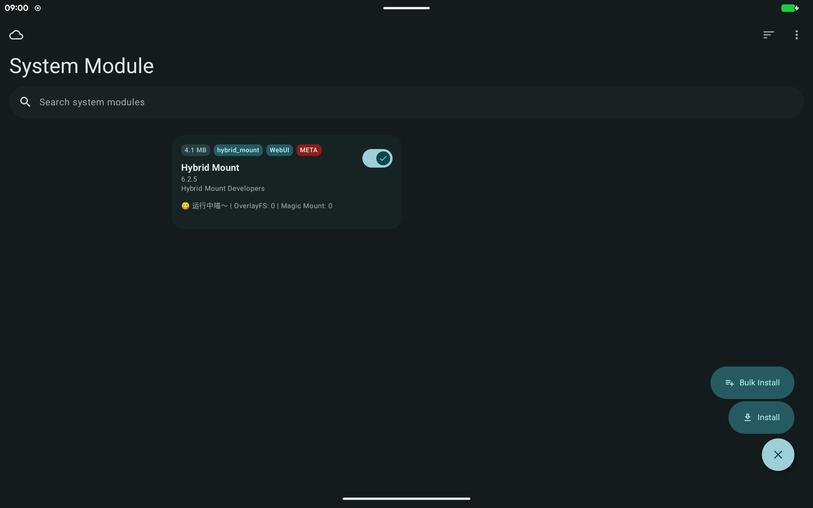
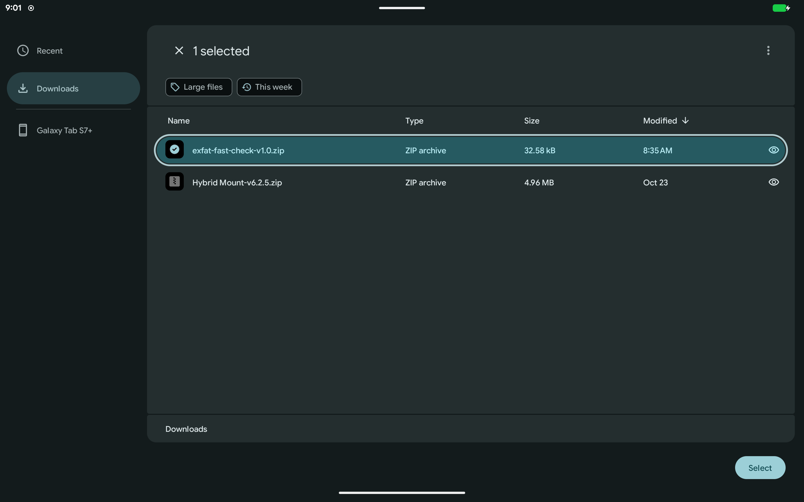
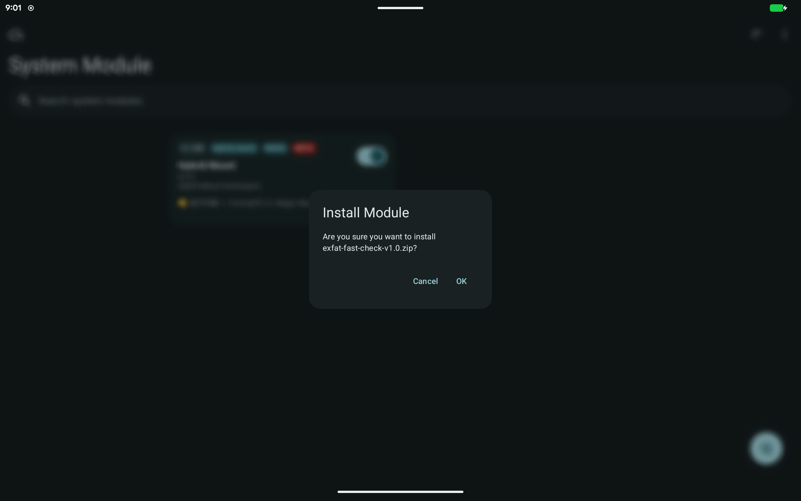
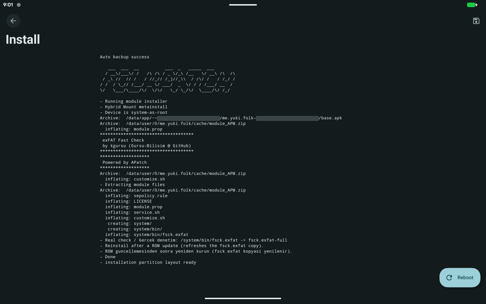
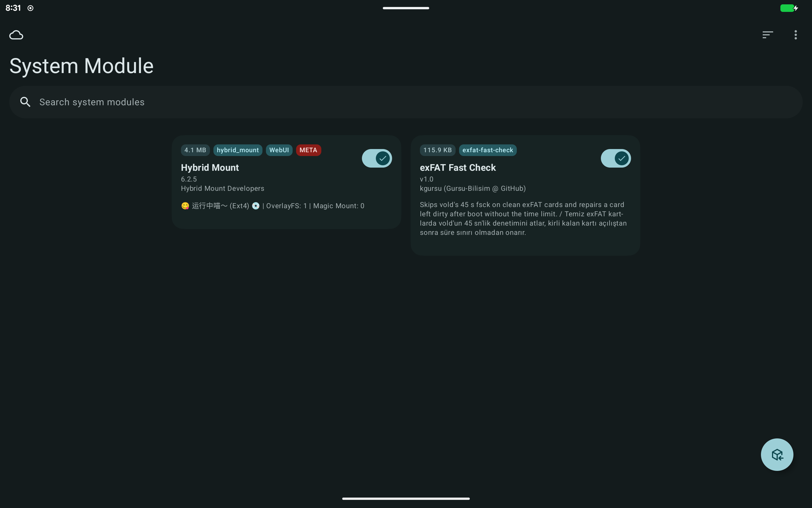
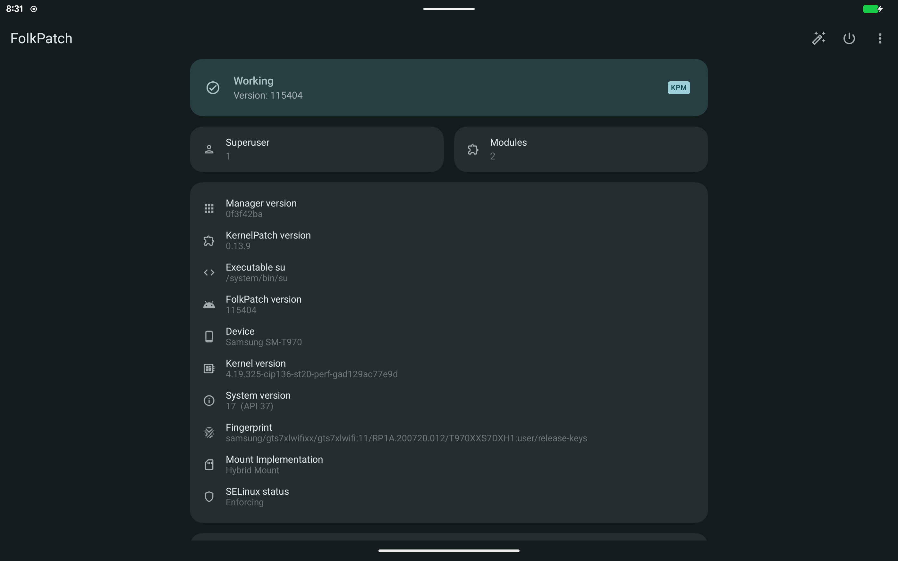

# exFAT Fast Check

[Türkçe](README.tr.md)

A root module that lets large exFAT SD cards mount at boot on Android versions whose `vold` kills the file system check after 45 seconds.

Author: kgursu (Gursu-Bilisim @ GitHub)

## The problem

`vold` checks every public volume with `fsck.exfat -y <device>` before mounting it and stops the check after 45 seconds (`kUntrustedFsckSleepTime`). The log then shows:

```
E vold    : Check failed (code 110)
E vold    : public:179,1 failed filesystem check
```

and the card is reported as damaged ("Issue with SD card"). Code 110 is `ETIMEDOUT`. On a large, well-filled card the full check takes longer than that even when the file system is healthy. Example from the test device (2 TB card, 8730 directories, 35329 files, exfatprogs 1.4.3, run as root):

```
fsck.exfat -n /dev/block/mmcblk0p1: clean. directories 8730, files 35329
    1m17.56s real     0m01.99s user     0m08.21s system
```

The killed check also leaves the VolumeDirty bit set (VolumeFlags at offset 106 reads `02 00` after the timeout, `00 00` after a completed check), so the card is in the same state on every boot.

Related reports: [LineageOS/issues #712](https://github.com/LineageOS/issues/issues/712), [exfatprogs #384](https://github.com/exfatprogs/exfatprogs/issues/384).

## How the module works

| File | Job |
|---|---|
| `system/bin/fsck.exfat` | Small static wrapper ([source](src/exfat-fast-check.c)). Only for vold's call form `-y <device>`: if the boot sector is exFAT and VolumeDirty and MediaFailure are clear, it returns 0 at once. Otherwise it runs the real check with the same arguments |
| `system/bin/fsck.exfat-full` | Copy of the ROM's own `fsck.exfat`, taken during installation |
| `sepolicy.rule` | Lets vold's check domain (`fsck_untrusted`) run the copy |
| `service.sh` | After boot, waits up to 5 minutes for vold's own check; if an exFAT volume is still `unmountable`, runs the full check without a time limit and asks vold to mount it again |

The module does not change what happens to a card that is marked dirty: it still gets a full check, only outside vold's time limit. Log file: `/data/adb/modules/exfat-fast-check/check.log`.

## Requirements

- arm64 device
- A root solution that mounts module `system/` files and reads `sepolicy.rule`
- Tested on: SM-T970 (gts7xlwifi), LineageOS 24 (`24.0-20261029-nightly`), FolkPatch 115404 with Hybrid Mount (OverlayFS mode). Magisk and KernelSU are not tested yet; reports are welcome.

## Installation

1. Download `exfat-fast-check-<version>.zip` from the Releases page.
2. Copy it to the device. Either copy it with a file manager or USB file transfer, or use adb:
   ```
   adb push exfat-fast-check-v1.0.zip /sdcard/Download/
   ```
3. FolkPatch / APatch / KernelSU: if your manager needs a metamodule for `system/` files (for example Hybrid Mount), install that first and reboot once. Without the reboot the manager does not accept other modules.
4. FolkPatch: open the System Module tab, tap the round button at the bottom right, then Install.

   

5. In the file picker open Downloads, select `exfat-fast-check-v1.0.zip` and tap Select.

   

6. Confirm with OK.

   

7. The install log lists the module files and ends with `- Done`. Tap Reboot.

   

8. After the reboot the module appears in System Module as exFAT Fast Check v1.0. With Hybrid Mount, its line shows `OverlayFS: 1`. If the card was not unmounted cleanly before the reboot, it is repaired and mounted about two minutes after startup; otherwise it is mounted right away. During testing this happened on three of eight reboots; the cause is not known yet (see [TESTING.md](TESTING.md)).

   

## Checking the result

After boot (allow 3 minutes if the card was dirty):

```
adb shell "sm list-volumes all"
```

The card should be `mounted`:

```
private mounted null
public:179,1 mounted 5A75-7508
emulated;0 mounted null
```

To confirm the wrapper is in place and labelled:

```
adb shell "su -c 'grep -c exfat-fast-check /system/bin/fsck.exfat; ls -lZ /system/bin/fsck.exfat /system/bin/fsck.exfat-full'"
```

Expected: a number of 1 or more, and both files with `u:object_r:fsck_exec:s0`:

```
2
-rwxr-xr-x 1 root shell u:object_r:fsck_exec:s0  27304 ... /system/bin/fsck.exfat
-rwxr-xr-x 1 root shell u:object_r:fsck_exec:s0  77624 ... /system/bin/fsck.exfat-full
```

What happened at boot:

```
adb shell "su -c 'cat /data/adb/modules/exfat-fast-check/check.log'"
adb shell "logcat -d -b all | grep -iE 'exfat-fast-check|Check OK|Check failed|avc.*fsck'"
```

A clean card shows `I vold : Check OK` a few seconds after boot. A card that was left dirty shows vold's timeout first and the repair about two minutes later; `check.log` from the test device:

```
2026-11-03 08:47:30 boot completed
2026-11-03 08:48:23 public:179,1 (5A75-7508): unmountable, VolumeFlags=0x02, full check started
exfatprogs version : 1.4.3 (2026-08-14)
/dev/block/vold/public:179,1: clean. directories 8731, files 35329
2026-11-03 08:49:40 public:179,1: full check finished, exit code 0
2026-11-03 08:49:41 public:179,1: sm mount requested
2026-11-03 08:49:46 public:179,1 (5A75-7508): mounted
```

An `avc ... fsck_exec` denial means the root solution did not load `sepolicy.rule` or did not keep the file labels. A `denied { read } ... tcontext=u:object_r:sysfs:s0` line for `fsck.exfat-full` also appears without the module and does not affect the check.

The FolkPatch home screen shows which mount implementation is active (Mount Implementation):



## Manual use

From a computer (adb):

```
adb shell "su -c '/system/bin/fsck.exfat-full -n /dev/block/mmcblk0p1'"
adb shell "su -c 'sh /data/adb/modules/exfat-fast-check/service.sh'"
```

The first line runs a read-only full check. The second repairs a card that became unmountable after boot (for example one inserted later). In a terminal app on the device, run the part inside the double quotes.

## After a ROM update

Reinstall the module. The installer takes a fresh copy of the ROM's `fsck.exfat`.

## Uninstall

Remove the module in the manager app and reboot. `/system/bin/fsck.exfat` is the ROM's own file again.

## Building

```
./build.sh
```

Needs `zig` (or `pip install ziglang`) and `zip`. The zip is written to `dist/`.

## License

GPL-3.0-or-later. See [LICENSE](LICENSE).

The module does not ship exfatprogs: `fsck.exfat-full` is copied from the ROM on the device during installation.
