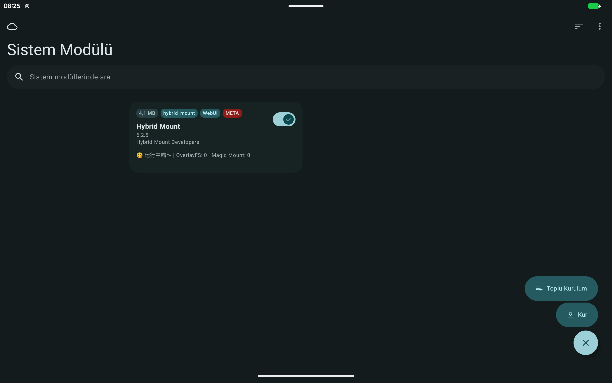
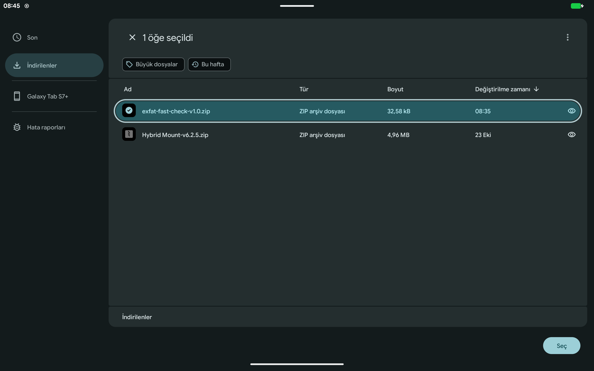
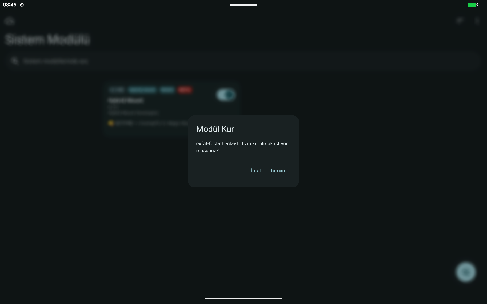
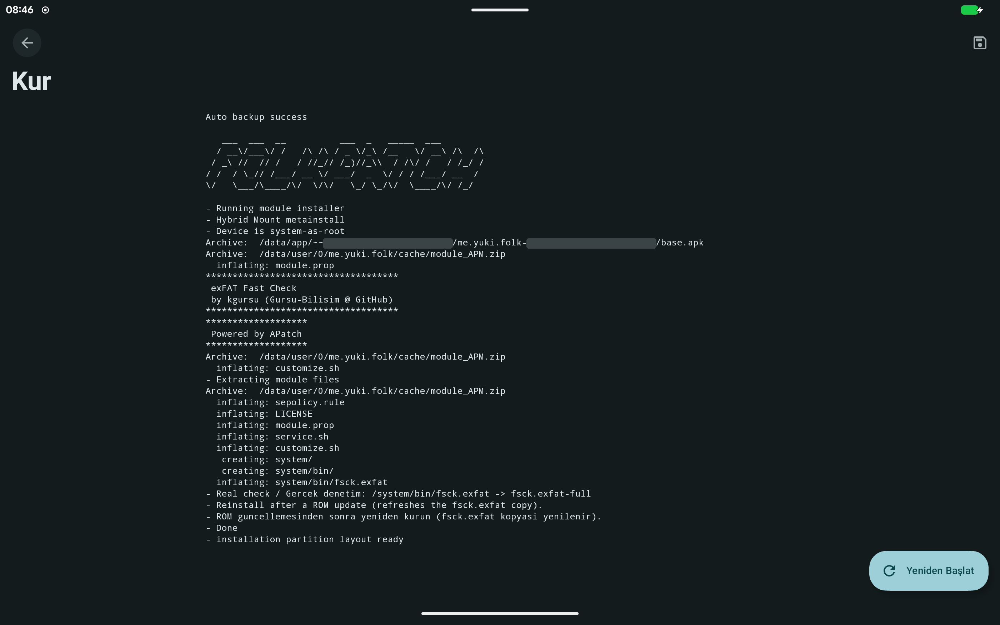
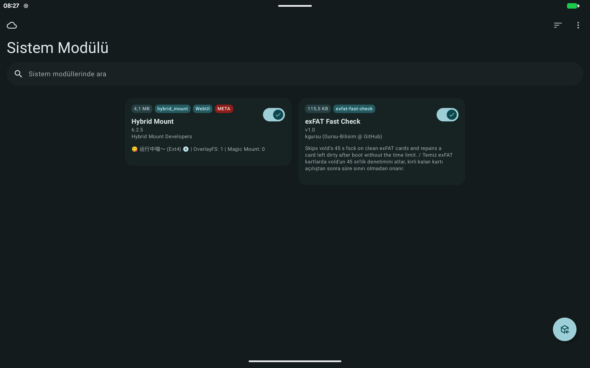
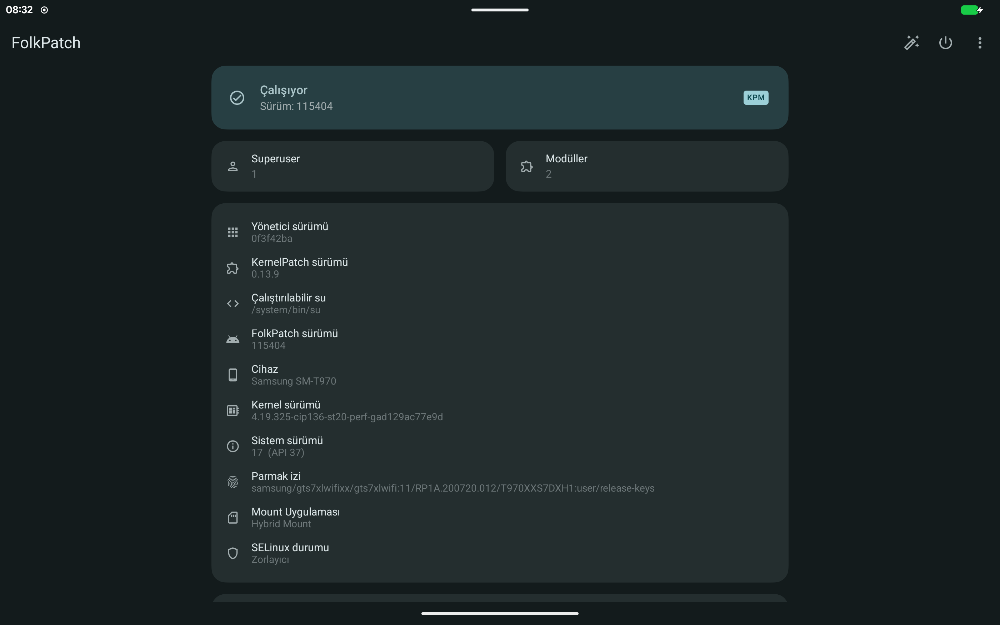

# exFAT Fast Check

[English](README.md)

`vold`'un dosya sistemi denetimini 45 saniyede kestiği Android sürümlerinde büyük exFAT SD kartların açılışta bağlanmasını sağlayan bir root modülü.

Yazar: kgursu (Gursu-Bilisim @ GitHub)

## Sorun

`vold` her harici kartı bağlamadan önce `fsck.exfat -y <aygıt>` ile denetliyor ve denetimi 45 saniye sonra durduruyor (`kUntrustedFsckSleepTime`). Logda şu satırlar çıkıyor:

```
E vold    : Check failed (code 110)
E vold    : public:179,1 failed filesystem check
```

Kart da bozuk olarak gösteriliyor ("SD kartla ilgili sorun"). 110 kodu `ETIMEDOUT`. Büyük ve dolu bir kartta dosya sistemi sağlam olsa bile tam denetim bu süreyi aşıyor. Test cihazından örnek (2 TB kart, 8730 dizin, 35329 dosya, exfatprogs 1.4.3, root ile):

```
fsck.exfat -n /dev/block/mmcblk0p1: clean. directories 8730, files 35329
    1m17.56s real     0m01.99s user     0m08.21s system
```

Kesilen denetim VolumeDirty bitini de açık bırakıyor (106. bayttaki VolumeFlags zaman aşımından sonra `02 00`, tamamlanan denetimden sonra `00 00`). Kart her açılışta aynı durumda kalıyor.

İlgili kayıtlar: [LineageOS/issues #712](https://github.com/LineageOS/issues/issues/712), [exfatprogs #384](https://github.com/exfatprogs/exfatprogs/issues/384).

## Modül nasıl çalışıyor

| Dosya | Görev |
|---|---|
| `system/bin/fsck.exfat` | Küçük statik sarmalayıcı ([kaynak](src/exfat-fast-check.c)). Yalnızca vold'un `-y <aygıt>` çağrısında çalışır: açılış sektörü exFAT ise ve VolumeDirty ile MediaFailure kapalıysa hemen 0 döner. Diğer durumlarda gerçek denetimi aynı argümanlarla çalıştırır |
| `system/bin/fsck.exfat-full` | Kurulum sırasında alınan, ROM'un kendi `fsck.exfat` kopyası |
| `sepolicy.rule` | vold'un denetim etki alanının (`fsck_untrusted`) bu kopyayı çalıştırmasına izin verir |
| `service.sh` | Açılıştan sonra vold'un kendi denetimini 5 dakikaya kadar bekler; bir exFAT birim hâlâ `unmountable` ise tam denetimi süre sınırı olmadan yapar ve vold'dan kartı yeniden bağlamasını ister |

Modül kirli işaretli bir kartın denetimini atlamaz: tam denetim yine yapılır, yalnızca vold'un süre sınırının dışında. Kayıt dosyası: `/data/adb/modules/exfat-fast-check/check.log`.

## Gereksinimler

- arm64 cihaz
- Modüllerin `system/` dosyalarını bağlayan ve `sepolicy.rule` okuyan bir root çözümü
- Denendiği ortam: SM-T970 (gts7xlwifi), LineageOS 24 (`24.0-20261029-nightly`), FolkPatch 115404 ve Hybrid Mount (OverlayFS kipi). Magisk ve KernelSU'da henüz denenmedi; geri bildirim beklenir.

## Kurulum

1. Releases sayfasından `exfat-fast-check-<sürüm>.zip` dosyasını indir.
2. Dosyayı cihaza kopyala. Dosya yöneticisi veya USB dosya aktarımı kullanabilir ya da adb ile gönderebilirsin:
   ```
   adb push exfat-fast-check-v1.0.zip /sdcard/Download/
   ```
3. FolkPatch / APatch / KernelSU: yönetici uygulaman `system/` dosyaları için bir metamodül istiyorsa (örneğin Hybrid Mount) önce onu kur ve bir kez yeniden başlat. Yeniden başlatmadan uygulama başka modül kabul etmiyor.
4. FolkPatch: Sistem Modülü sekmesini aç, sağ alttaki yuvarlak düğmeye ve ardından Kur'a dokun.

   

5. Dosya seçicide İndirilenler'i aç, `exfat-fast-check-v1.0.zip` dosyasını seç ve Seç'e dokun.

   

6. Onay penceresinde Tamam'a dokun.

   

7. Kurulum kaydı modül dosyalarını listeler ve `- Done` satırıyla biter. Yeniden Başlat'a dokun.

   

8. Açılıştan sonra modül Sistem Modülü sekmesinde exFAT Fast Check v1.0 olarak görünür. Hybrid Mount kullanılıyorsa onun satırında `OverlayFS: 1` yazar.

   

## Sonucu kontrol etme

Açılıştan sonra (kart kirliyse 3 dakika bekle):

```
adb shell "sm list-volumes all"
```

Kart `mounted` görünmeli:

```
private mounted null
public:179,1 mounted 5A75-7508
emulated;0 mounted null
```

Sarmalayıcının yerinde ve doğru etiketli olduğunu görmek için:

```
adb shell "su -c 'grep -c exfat-fast-check /system/bin/fsck.exfat; ls -lZ /system/bin/fsck.exfat /system/bin/fsck.exfat-full'"
```

Beklenen: 1 veya daha büyük bir sayı ve iki dosyada da `u:object_r:fsck_exec:s0`:

```
2
-rwxr-xr-x 1 root shell u:object_r:fsck_exec:s0  27304 ... /system/bin/fsck.exfat
-rwxr-xr-x 1 root shell u:object_r:fsck_exec:s0  77624 ... /system/bin/fsck.exfat-full
```

Açılışta ne olduğu:

```
adb shell "su -c 'cat /data/adb/modules/exfat-fast-check/check.log'"
adb shell "logcat -d -b all | grep -iE 'exfat-fast-check|Check OK|Check failed|avc.*fsck'"
```

Temiz bir kartta açılıştan birkaç saniye sonra `I vold : Check OK` görünür. Kirli kalmış bir kartta önce vold'un zaman aşımı, yaklaşık iki dakika sonra onarım görünür. Test cihazındaki `check.log`:

```
2026-11-03 08:47:30 boot completed
2026-11-03 08:48:23 public:179,1 (5A75-7508): unmountable, VolumeFlags=0x02, full check started
exfatprogs version : 1.4.3 (2026-08-14)
/dev/block/vold/public:179,1: clean. directories 8731, files 35329
2026-11-03 08:49:40 public:179,1: full check finished, exit code 0
2026-11-03 08:49:41 public:179,1: sm mount requested
2026-11-03 08:49:46 public:179,1 (5A75-7508): mounted
```

`avc ... fsck_exec` reddi, root çözümünün `sepolicy.rule` dosyasını yüklemediğini ya da dosya etiketlerini korumadığını gösterir. `fsck.exfat-full` için görülen `denied { read } ... tcontext=u:object_r:sysfs:s0` satırı modül olmadan da çıkar ve denetimi etkilemez.

FolkPatch ana ekranı hangi bağlama yönteminin etkin olduğunu gösterir (Mount Uygulaması):



## Elle kullanım

Bilgisayardan (adb):

```
adb shell "su -c '/system/bin/fsck.exfat-full -n /dev/block/mmcblk0p1'"
adb shell "su -c 'sh /data/adb/modules/exfat-fast-check/service.sh'"
```

İlk satır salt okunur tam denetim yapar. İkincisi açılıştan sonra bağlanamaz hale gelen kartı (örneğin sonradan takılanı) onarır. Cihazdaki bir terminal uygulamasında çift tırnak içindeki kısmı çalıştır.

## ROM güncellemesinden sonra

Modülü yeniden kur. Kurulum ROM'un `fsck.exfat` dosyasının güncel kopyasını alır.

## Kaldırma

Modülü yönetici uygulamadan kaldır ve yeniden başlat. `/system/bin/fsck.exfat` yeniden ROM'un kendi dosyası olur.

## Derleme

```
./build.sh
```

`zig` (ya da `pip install ziglang`) ve `zip` gerekir. Zip dosyası `dist/` altına yazılır.

## Lisans

GPL-3.0-or-later. Ayrıntı: [LICENSE](LICENSE).

Modül exfatprogs içermez: `fsck.exfat-full` kurulum sırasında cihazdaki ROM'dan kopyalanır.
